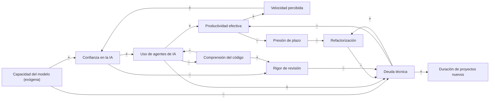

# Proyecto D.S. — Sistema experimental y marco metodológico

David Reyes y David Gutiérrez · Oct 27, 2026

## 1. Planteamiento resumido

El sistema estudiado es un equipo de desarrollo y sus agentes de IA tratados como un solo sistema: la IA acelera la entrega al inicio, pero la deuda técnica que deja puede frenar al equipo meses después y arrastrarse a proyectos nuevos.

**Pregunta:** ¿Cómo afectan, positiva y negativamente, los agentes de IA los tiempos de desarrollo a corto y largo plazo, y cómo la mejora constante de los modelos interviene con el tiempo en el comportamiento y la confianza de los equipos?

**Hipótesis operacionales** (formuladas para poder probarlas en simulación):

- **H1.** Con uso intensivo de IA y revisión baja, la velocidad de entrega sube en los primeros meses y luego cae por debajo del escenario sin IA, porque la deuda técnica reduce la productividad efectiva.
- **H2.** La deuda no pagada en un proyecto se hereda (código y componentes reutilizados) y alarga la duración de los proyectos siguientes.
- **H3.** Una mayor capacidad de los modelos eleva la confianza del equipo y reduce la revisión; si la calidad del código no mejora al mismo ritmo, la deuda crece aunque el modelo sea mejor.
- **H4.** Políticas de revisión obligatoria y un presupuesto fijo de refactorización conservan la mayor parte de la ganancia de velocidad y evitan el estancamiento.

## 2. Sistema experimental

El sistema experimental es un modelo de simulación de un equipo de 6 desarrolladores que ejecuta proyectos sucesivos sobre una misma base de código durante 104 semanas (2 años), con paso de tiempo de 0,25 semanas. Los valores numéricos son iniciales: se calibran en la fase 4 con encuesta, métricas de repositorio y literatura.

### 2.1 Frontera del sistema

| Tipo | Variables |
| --- | --- |
| Endógenas (las calcula el modelo) | Backlog, entregas, deuda técnica, confianza en la IA, comprensión del código, presión de plazo, uso de IA, rigor de revisión |
| Exógenas (entran como datos o escenarios) | Capacidad de los modelos de IA (curva de mejora), tamaño del equipo, alcance de cada proyecto, fecha de entrega |
| Excluidas | Rotación de personal, costo de licencias, contratación, cambios de requisitos del cliente |

### 2.2 Niveles (stocks)

| Nivel | Unidad | Valor inicial | Qué representa |
| --- | --- | --- | --- |
| Backlog pendiente (B) | tareas | 300 por proyecto | Trabajo por hacer del proyecto activo |
| Tareas completadas (C) | tareas | 0 | Funcionalidad entregada acumulada |
| Deuda técnica (D) | tareas de retrabajo | 20 | Código duplicado, sin pruebas o mal estructurado que exige retrabajo |
| Confianza en la IA (K) | 0–1 | 0,3 | Cuánto confía el equipo en el código que genera el agente |
| Comprensión del código (U) | 0–1 | 0,8 | Qué tanto el equipo entiende su propia base de código |

### 2.3 Flujos

| Flujo | Entra a / sale de | Unidad |
| --- | --- | --- |
| Tasa de desarrollo | sale de B, entra a C | tareas/semana |
| Generación de deuda | entra a D | tareas/semana |
| Pago de deuda (refactorización) | sale de D | tareas/semana |
| Ajuste de confianza | entra o sale de K | 1/semana |
| Aprendizaje y erosión de comprensión | entra o sale de U | 1/semana |
| Llegada de proyecto nuevo | pulso que recarga B; D se conserva | tareas |

### 2.4 Variables auxiliares y parámetros

| Variable | Tipo | Valor o forma inicial |
| --- | --- | --- |
| Productividad base | parámetro | 2 tareas/persona/semana |
| Capacidad del modelo (M) | exógena | 0,5 que sube a 0,9 en 104 semanas (curva S) |
| Fracción de trabajo con IA (a) | auxiliar | Función creciente de K, entre 0 y 0,9 |
| Multiplicador de velocidad IA | auxiliar | 1 + g · a · M, con g = 0,8 |
| Rigor de revisión (r) | auxiliar | Baja con K y con la presión de plazo; sube con U |
| Efecto de la deuda en productividad | tabla | 1 sin deuda, 0,5 con deuda igual a 50% del backlog |
| Presión de plazo (P) | auxiliar | Tareas pendientes / (semanas restantes × capacidad) |
| Fracción asignada a refactorizar (f) | política | 5% base; 20% en escenarios de control |
| Velocidad percibida | auxiliar | Promedio móvil de 4 semanas de la tasa de desarrollo |
| Incidentes percibidos | auxiliar | Proporcional a D × (1 − r) |

### 2.5 Supuestos

- Todas las tareas tienen el mismo tamaño y el equipo es homogéneo.
- La deuda no desaparece al cerrar un proyecto: el siguiente arranca con la deuda acumulada (esto prueba H2).
- La confianza se ajusta con retraso (tiempo de ajuste de 8 semanas): el equipo reacciona a lo que percibe, no a la deuda real.
- La mejora del modelo reduce los defectos por tarea, pero más lento de lo que sube la confianza (esto prueba H3).

## 3. Diagrama causal e hipótesis dinámica

La hipótesis dinámica es que R1 domina los primeros meses (la velocidad sube) y después B1 y R2 toman el control: la deuda frena la productividad y la presión elimina el tiempo para pagarla.



| Bucle | Tipo | Recorrido |
| --- | --- | --- |
| R1 Entusiasmo | Reforzador | Confianza → Uso de IA → Productividad → Velocidad percibida → Confianza |
| B1 Fricción de la deuda | Compensador | Confianza → Uso de IA → Deuda → Productividad (−) → Velocidad percibida → Confianza |
| R2 Trampa de la presión | Reforzador | Deuda → Productividad (−) → Presión (−) → Refactorización (−) → Deuda (−) |
| B2 Pago de deuda | Compensador | Deuda → Refactorización → Deuda (−) |
| R3 Dependencia | Reforzador | Uso de IA → Comprensión (−) → Uso de IA (−) |

La capacidad del modelo actúa por dos vías opuestas: reduce la deuda por tarea, pero sube la confianza, y la confianza baja el rigor de revisión. La deuda también alarga los proyectos nuevos porque se hereda en la base de código (H2).

## 4. Modelo de stocks y flujos (ecuaciones iniciales)

Estas ecuaciones son la primera versión para Vensim PLE o PySD; los coeficientes griegos son parámetros a calibrar. N es el tamaño del equipo y p0 la productividad base.

**Niveles**

```latex
\begin{aligned}
\frac{dB}{dt} &= -\,Des + Proy(t) \\
\frac{dC}{dt} &= Des \\
\frac{dD}{dt} &= Gen - Pago \\
\frac{dK}{dt} &= \frac{K^{*} - K}{\tau_K} \\
\frac{dU}{dt} &= \lambda\,(1-a)\,(1-U) \;-\; \mu\,a\,(1-r)\,U
\end{aligned}
```

**Flujos**

```latex
\begin{aligned}
Des &= N\,p_0\,(1-f)\,(1 + g\,a\,M)\,E_D\!\left(\tfrac{D}{B_0}\right) \\
Gen &= Des\,\big[\delta_h\,(1-a) + \delta_{IA}\,(1-M)\,a\big]\,(1-r) \\
Pago &= \min\!\big(D/\Delta t,\; N\,p_0\,f\,E_D\big)
\end{aligned}
```

**Auxiliares**

```latex
\begin{aligned}
a &= a_{max}\,K \\
r &= r_0\,U\,(1-\kappa K)\,E_P(P) \\
K^{*} &= \mathrm{lim}_{[0,1]}\Big(K_0 + \alpha\big(\tfrac{V}{V_0}-1\big) + \beta\,M - \gamma\,I\Big) \\
I &= \eta\,D\,(1-r)
\end{aligned}
```

| Símbolo | Significado | Valor inicial |
| --- | --- | --- |
| Proy(t) | Pulso de 300 tareas al iniciar cada proyecto | semanas 0, 26, 52, 78 |
| E\_D | Tabla: efecto de la deuda en productividad | 1 → 0,5 |
| E\_P | Tabla: la presión de plazo reduce la revisión | 1 → 0,4 |
| δh, δIA | Deuda por tarea manual y por tarea con IA | 0,05 y 0,35 |
| τK | Retraso de ajuste de la confianza | 8 semanas |
| λ, μ | Ritmo de aprendizaje y de erosión de la comprensión | 0,05 y 0,04 por semana |
| α, β, γ, κ, η | Sensibilidades de confianza y revisión | a calibrar |

El término (1 − M) en la generación de deuda es la forma en que la mejora del modelo entra al sistema: cada versión reduce la deuda por tarea, pero β · M sube la confianza y κ · K baja la revisión, y el saldo neto es lo que responde a H3.

## 5. Escenarios y diseño de experimentos

Cada hipótesis se prueba comparando escenarios contra una línea base sin IA, con los mismos 4 proyectos y el mismo horizonte de 104 semanas.

| Escenario | Qué cambia | Prueba |
| --- | --- | --- |
| E0 Sin IA | a = 0 fijo | Línea base |
| E1 Adopción libre | a sube con K; f = 5%; revisión baja con la presión | H1, H2 |
| E2 Revisión obligatoria | r no puede bajar de 0,7 | H4 |
| E3 Presupuesto de refactorización | f = 20% fijo | H4 |
| E4 Mejora acelerada del modelo | M llega a 0,9 en 52 semanas en vez de 104 | H3 |
| E5 Mejora sin control | E4 + κ alto (el equipo deja de revisar) | H3 |
| E6 Política combinada | E2 + E3 + E4 | H4 |

### 5.1 Indicadores de salida

- Duración de cada proyecto (semanas hasta B = 0) y su tendencia del proyecto 1 al 4.
- Tareas entregadas por semana a lo largo del horizonte.
- Deuda técnica pico y deuda al final de cada proyecto.
- Semana de cruce: cuando la entrega acumulada con IA cae por debajo de E0 (si ocurre).
- Confianza y comprensión al final del horizonte.

### 5.2 Experimentos

1. **Corrida determinística** de E0 a E6 y comparación de los indicadores.
2. **Sensibilidad univariada** de δIA, τK, κ y f (±50%) para ver cuáles cambian la conclusión.
3. **Monte Carlo** (200 corridas, distribuciones uniformes en los parámetros inciertos) para obtener bandas de confianza del 90% de la duración de proyectos.
4. **Barrido de política**: f de 0% a 30% en pasos de 5% para encontrar el presupuesto de refactorización que maximiza la entrega acumulada a 104 semanas.

**Criterio de decisión:** H1 se acepta si en E1 la entrega acumulada supera a E0 en las primeras 26 semanas y queda por debajo antes de la semana 104 en la mayoría de corridas Monte Carlo; H2, si la duración crece de un proyecto al siguiente en E1 y no en E0.

## 6. Marco metodológico

La investigación es de enfoque mixto con predominio cuantitativo, de alcance explicativo y diseño no experimental en el mundo real, con experimentación por simulación (escenarios in silico). Sigue el proceso de modelado de dinámica de sistemas de Sterman: problema, hipótesis dinámica, formulación, validación y políticas.

### 6.1 Fases

1. **Articulación del problema.** Definir el comportamiento de referencia: velocidad que sube al adoptar IA y luego se estanca o cae; horizonte de 104 semanas.
2. **Hipótesis dinámica.** Construir el diagrama causal (sección 3) y validarlo con entrevistas.
3. **Formulación.** Pasar el diagrama a stocks y flujos en Vensim PLE (gratuito para uso académico) o PySD en Python (sección 4).
4. **Recolección de datos y calibración.** Encuesta, entrevistas, métricas de repositorios y literatura (6.2).
5. **Validación.** Pruebas estructurales y de comportamiento (6.4).
6. **Diseño y evaluación de políticas.** Correr los escenarios E0–E6 y los experimentos de la sección 5.

### 6.2 Fuentes de datos

| Fuente | Qué aporta | Calibra |
| --- | --- | --- |
| Literatura empírica | Magnitudes de referencia de velocidad, estabilidad y calidad del código con IA (6.3) | g, δIA, E\_D, retraso de percepción |
| Encuesta a desarrolladores (meta: 30 o más respuestas) | % de código generado con IA, confianza, prácticas de revisión, velocidad percibida, horas en retrabajo | K0, a\_max, r0, κ |
| Entrevistas semiestructuradas (4 a 6 líderes técnicos) | Confirmar relaciones causales, retrasos y políticas reales del equipo | estructura, τK, f |
| Métricas de repositorio (GitHub API + SonarQube) | Churn a 2 semanas, duplicación, índice de deuda técnica, tiempo de ciclo de PR, antes y después de adoptar IA | δh, δIA, comportamiento de referencia |

Para las métricas de repositorio sirve un proyecto real del equipo, por ejemplo el del Geoportal SIMAC si allí se usan agentes, comparando commits con y sin asistencia de IA.

### 6.3 Evidencia de referencia para calibrar

- **METR (2025).** En un ensayo aleatorizado con 16 desarrolladores experimentados y 246 tareas reales, quienes podían usar IA tardaron 19% más, aunque antes estimaban ir 24% más rápido ([fuente](https://online.thedailystar.net/node/3937931)). Calibra la brecha entre velocidad percibida y real que alimenta la confianza.
- **DORA (2024).** Un aumento de 25% en la adopción de IA se asoció con una caída estimada de 1,5% en rendimiento de entrega y de 7,2% en estabilidad ([fuente](https://cloud.google.com/blog/products/devops-sre/announcing-the-2024-dora-report)). Orden de magnitud para E\_D y los incidentes.
- **GitClear (2025).** Analizó 211 millones de líneas modificadas entre 2020 y 2024 y reportó más duplicación y churn y menos refactorización ([fuente](https://www.i-programmer.info/news/105-artificial-intelligence/17871-gitclear-reveals-ais-negative-impact-on-code-quality.html)). Sirve para estimar δIA y la caída del pago de deuda.

### 6.4 Validación del modelo

| Prueba | Qué se verifica |
| --- | --- |
| Consistencia dimensional | Todas las ecuaciones cierran en unidades (Vensim Units Check) |
| Condiciones extremas | Con a = 0 el modelo reproduce E0; con N = 0 no hay desarrollo ni deuda nueva |
| Verificación de estructura | Los líderes entrevistados reconocen cada relación del diagrama causal |
| Reproducción de comportamiento | E1 muestra ganancia inicial y luego pérdida de velocidad, como en la evidencia de 6.3 |
| Sensibilidad | Las conclusiones de H1–H4 no se invierten con ±50% en los parámetros inciertos |
| Error de integración | Resultados iguales con paso de 0,25 y 0,125 semanas |

### 6.5 Instrumentos y ética

- Cuestionario Likert de 5 puntos en Google Forms, con consentimiento informado y respuestas anónimas.
- Guía de entrevista de 10 preguntas abiertas, grabada solo con autorización.
- Script en Python (PyGithub) para extraer commits y PR, y SonarQube Community para deuda y duplicación.
- Limitación: la muestra local no permite generalizar; el modelo explica mecanismos, no predice cifras exactas.

### 6.6 Catálogo de fuentes para calibrar el modelo

La fuente más cercana al modelo es He et al. (MSR 2026): mide en repositorios reales que la velocidad sube y se disipa en 2 meses mientras la deuda persiste y luego frena la velocidad, que es exactamente el bucle B1. Se priorizan ensayos aleatorizados, estudios causales con repositorios y encuestas grandes; los informes de proveedores (GitClear, Stripe) se usan solo como orden de magnitud.

| Fuente | Tipo y tamaño | Dato clave | Calibra |
| --- | --- | --- | --- |
| [He et al. (2026), Cursor en GitHub](https://arxiv.org/abs/2511.04427) | Diferencias en diferencias, repositorios con grupo control (MSR 2026) | Aumento de 3 a 5 veces en líneas el primer mes que desaparece a los 2 meses; advertencias de análisis estático +30% y complejidad +41% persistentes; la peor calidad causa la caída posterior de velocidad | g, δIA, E\_D, comportamiento de referencia |
| [Agarwal, He y Vasilescu (2026), agentes autónomos](https://arxiv.org/abs/2601.13597) | Diferencias en diferencias con el dataset AIDev; paquete de replicación en [GitHub](https://github.com/shyamagarwal13/agentic-coding-impact) | La ganancia de velocidad grande solo ocurre cuando el agente es la primera herramienta de IA del proyecto; rendimientos decrecientes | g, forma de la curva de adopción |
| [AIDev (Li et al., 2025)](https://github.com/SAILResearch/AI_Teammates_in_SE3) | Dataset abierto: 932.791 PRs de Codex, Devin, Copilot, Cursor y Claude Code ([fuente](https://www.themoonlight.io/review/aidev-studying-ai-coding-agents-on-github)) | Tasa de aceptación de PRs de agentes entre 35% y 64% frente a cerca de 77% en humanos ([fuente](https://api.emergentmind.com/topics/aidev-dataset)) | δIA, rigor de revisión r0 |
| [Cui et al. (2025), Microsoft, Accenture y una Fortune 100](https://demirermert.github.io/Papers/Demirer_AI_productivity.pdf) | 3 ensayos aleatorizados de campo, cerca de 5.000 desarrolladores | +26% de PRs completados en conjunto; más ganancia en desarrolladores jóvenes ([resumen](https://newsletter.getdx.com/p/copilot-impact-on-productivity)) | g (cota superior) |
| [METR (2025)](https://metr.org/blog/2025-07-10-early-2025-ai-experienced-os-dev-study/) | Ensayo aleatorizado, 16 desarrolladores expertos, 246 tareas | 19% más lentos con IA aunque esperaban ir 24% más rápido; en 2026 METR marcó el resultado como desactualizado ([fuente](https://www.youngju.dev/blog/2026-07-12-ai-developer-productivity-reality.en)) | g (cota inferior), brecha percibida vs. real (α, τK) |
| [Anthropic (2026), formación de habilidades](https://www.anthropic.com/research/AI-assistance-coding-skills) | Ensayo aleatorizado, 52 desarrolladores | 17% menos en la prueba de comprensión con IA, mayor brecha en depuración; quien pide explicaciones conserva más ([fuente](https://infoq.com/news/2026/02/ai-coding-skill-formation/)) | μ (erosión de comprensión), U |
| [Stack Overflow Developer Survey 2025](https://survey.stackoverflow.co/2025/) | Encuesta de casi 50.000 desarrolladores; microdatos descargables | 46% desconfía de la precisión de la IA y 33% confía; la confianza bajó desde 43% en 2024; 66% reporta soluciones "casi correctas" ([fuente](https://leaddev.com/technical-direction/trust-in-ai-coding-tools-is-plummeting)) | K0, γ (incidentes que bajan confianza) |
| [DORA 2024](https://cloud.google.com/blog/products/devops-sre/announcing-the-2024-dora-report) y [DORA 2025](https://dora.dev/dora-report-2025/) | Encuestas globales (casi 5.000 profesionales en 2025) | 2024: más adopción asociada a menos rendimiento y estabilidad; 2025: 90% de adopción y relación con rendimiento ya positiva ([fuente](https://blog.google/technology/developers/dora-report-2025/)) | a\_max, efecto de M en el tiempo (H3) |
| [Besker, Martini y Bosch (2019)](https://research.chalmers.se/en/publication/511450) | Estudio longitudinal, 43 desarrolladores + 16 entrevistas (Journal of Systems and Software) | 23% del tiempo se pierde por deuda técnica, y la deuda existente obliga a crear deuda nueva | E\_D, refuerza R2 |
| [GitClear (2025)](https://www.i-programmer.info/news/105-artificial-intelligence/17871-gitclear-reveals-ais-negative-impact-on-code-quality.html) | 211 millones de líneas modificadas 2020–2024 (informe de proveedor) | Más duplicación y churn, menos refactorización | δIA, caída de f |
| [Stripe, Developer Coefficient](https://stripe.com/files/reports/the-developer-coefficient.pdf) | Encuesta a cerca de 1.500 desarrolladores y líderes (proveedor) | 13,5 de 41,1 horas semanales en deuda técnica ([fuente](https://lsvp.com/stories/the-developer-productivity-manifesto-part-3-leaving-software-on-the-table)) | E\_D (cota superior) |

**Datos crudos descargables** para trabajar en Python: microdatos de Stack Overflow 2025 (CSV), AIDev (Hugging Face y Zenodo) y los paquetes de replicación de He et al. y Agarwal et al. Con ellos se puede reproducir la curva de velocidad y calidad mes a mes y usarla como comportamiento de referencia en la validación (6.4).

**Rangos iniciales sugeridos:** g entre −0,2 y +0,3 (METR y Cui et al. como cotas); E\_D con pérdida de 23% a 33% del tiempo en deuda alta (Besker y Stripe); μ tal que la comprensión caiga cerca de 17% con uso intensivo (Anthropic). Estos rangos son los que se usan en el Monte Carlo (5.2).

Antes de citar un número en el informe final, verifiquen la cifra en el artículo original: varias filas enlazan un resumen secundario además del estudio.

## 7. Cronograma y entregables

Plan de 8 semanas contadas desde el inicio del trabajo; se ajusta a la fecha de entrega del curso.

1. **Semanas 1–2:** diagrama causal final, cuestionario y guía de entrevista listos. Entregable: hipótesis dinámica.
2. **Semanas 2–4:** aplicación de encuesta, entrevistas y extracción de métricas del repositorio. Entregable: base de datos de calibración.
3. **Semanas 3–5:** modelo de stocks y flujos en Vensim y calibración inicial. Entregable: modelo .mdl.
4. **Semana 6:** pruebas de validación. Entregable: informe de validación.
5. **Semanas 6–7:** escenarios E0–E6, sensibilidad y Monte Carlo. Entregable: gráficas comparativas.
6. **Semana 8:** análisis, conclusiones sobre H1–H4 y recomendaciones. Entregable: documento final y presentación.

- [ ] Confirmar la fecha de entrega del curso
- [ ] Elegir el repositorio para las métricas
- [ ] Definir Vensim PLE o PySD

## 8. Referencias base

- Sterman, J. D. (2000). *Business Dynamics: Systems Thinking and Modeling for a Complex World*. McGraw-Hill.
- Barlas, Y. (1996). Formal aspects of model validity and validation in system dynamics. *System Dynamics Review*, 12(3), 183–210.
- Abdel-Hamid, T. y Madnick, S. (1991). *Software Project Dynamics: An Integrated Approach*. Prentice Hall.
- METR (2025). *Measuring the Impact of Early-2025 AI on Experienced Open-Source Developer Productivity* ([resumen](https://online.thedailystar.net/node/3937931)).
- Google Cloud DORA (2024). *Accelerate State of DevOps Report* ([resumen](https://cloud.google.com/blog/products/devops-sre/announcing-the-2024-dora-report)).
- GitClear (2025). *AI Copilot Code Quality* ([resumen](https://www.i-programmer.info/news/105-artificial-intelligence/17871-gitclear-reveals-ais-negative-impact-on-code-quality.html)).

Abdel-Hamid y Madnick es el antecedente clásico de dinámica de sistemas aplicada a proyectos de software; conviene citarlo en el estado del arte.
